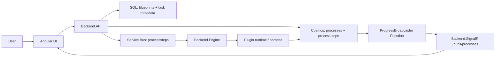

# Topology and Runtime

## Topology Source of Truth

`Backend.AppHost/Program.cs` is the source of truth for the local distributed topology.

Key runtime resources wired there:

- SQL Server database for blueprint and task metadata
- Cosmos DB database with containers:
  - `processes`
  - `processsteps`
  - `processstepprogressleases`
- Blob Storage container for plugin bundles
- Service Bus queues for:
  - process-step execution
  - plugin reload
- Grafana, Loki, Tempo, Prometheus, and Alloy for observability
- API, Engine, SignalR, Plugin Detector, Progress Broadcaster, Plugin Seeder, and Blueprint Seeder services

The API currently exposes a fixed external HTTP endpoint on port `5180` in the AppHost.

## Service Ownership

| Service | Owns |
|---|---|
| `Backend.API` | Blueprint/process HTTP API, process queries, client-config |
| `Backend.Engine` | Consumes process-step messages and executes plugins |
| `Backend.SignalR` | Hosts `/hubs/processes` subscriptions |
| `PluginDetector` | Reacts to plugin bundle uploads and registers task versions |
| `ProgressBroadcaster` | Watches Cosmos process-step changes and publishes SignalR updates |
| `PluginSeeder` | Seeds canonical bundles from `Backend.Plugins/_bundles` into blob storage |
| `BlueprintSeeder` | Seeds exported blueprints into the API |

## Runtime Flow

## Process Lifecycle

1. The frontend calls `POST /api/blueprints/{id}/processes`.
2. The API resolves the selected blueprint version and creates initial process state.
3. The API persists process and step state, then enqueues the next process-step message.
4. `Backend.Engine` consumes the process-step queue.
5. The engine loads the executable blueprint, resolves the matching task version, and starts a job.
6. The plugin runtime launches the plugin executable through the harness.
7. The plugin hydrates its required input/global state from Cosmos using the invocation envelope identifiers.
8. The plugin emits result data; the engine updates process-step state and queues downstream work as needed.
9. Cosmos changes in `processsteps` are observed by `ProgressBroadcaster`.
10. `ProgressBroadcaster` builds realtime batches and publishes them to SignalR subscribers.
11. The UI receives `processSummaryUpdated` and `processStepsUpdated` events and refreshes the process explorer state.

## Plugin Ingestion Path

1. Canonical bundle ZIPs are uploaded to the plugin blob container.
2. `PluginDetector` extracts the bundle, reads `manifest.json` and schemas, and registers or updates task versions in SQL.
3. The detector emits a plugin reload request so the engine refreshes its in-memory runtime catalog.

## Important Runtime Invariants

- AppHost is the only authoritative place for local topology wiring.
- SQL is design-time and catalog state; Cosmos is live runtime state.
- The engine depends on the process-step queue configuration staying aligned across AppHost, Engine, tests, and smoke scripts.
- The progress broadcaster depends on Cosmos binding configuration being correct at startup.
- Realtime is part of the normal product flow, not optional observability garnish.
