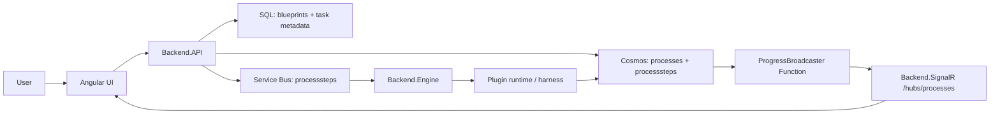

# Topology and Runtime

## Topology Source of Truth

`Backend.AppHost/Program.cs` is the source of truth for the local distributed topology.

Key runtime resources wired there:

- SQL Server database for blueprint and task metadata
- Cosmos DB database with containers:
  - `processes`
  - `processsteps`
  - `processstepfinalizations`
  - `processstepprogressleases`
- Blob Storage container for plugin bundles
- Service Bus queues for:
  - process-step execution
  - plugin reload
- Grafana, Loki, Tempo, Prometheus, and Alloy for observability
- API, Engine, SignalR, Plugin Detector, Progress Broadcaster, Plugin Seeder, and Blueprint Seeder services

The API currently exposes a fixed external HTTP endpoint on port `5180` in the AppHost. The UI development proxy expects the API/client-config path to remain aligned with AppHost.

## Service Ownership

| Service | Owns |
|---|---|
| `Backend.API` | Blueprint/process HTTP API, process queries, client-config |
| `Backend.Engine` | Consumes process-step messages, validates plugin capabilities/configuration, executes plugins, and runs native Collection Iterator steps |
| `Backend.SignalR` | Hosts `/hubs/processes` subscriptions |
| `PluginDetector` | Reacts to plugin bundle uploads and registers task versions |
| `ProgressBroadcaster` | Watches Cosmos process-step changes and publishes SignalR updates |
| `PluginSeeder` | Seeds canonical bundles from `Backend.Plugins/_bundles` into blob storage |
| `BlueprintSeeder` | Seeds exported blueprints into the API |

## Design-Time Storage

SQL owns:

- blueprints and blueprint versions
- blueprint nodes and connections
- task definitions and task versions
- Collection Iterator node metadata
- phased blueprint definitions and versions
- phased blueprint phases, transitions, handoff mappings, and correlation mappings

Hand-authored migrations in `Backend.Database.Relational/Migrations` must remain discoverable by the migration service.

## Runtime Flow

## Process Lifecycle

1. The frontend calls `POST /api/blueprints/{id}/processes`.
2. The API resolves the selected blueprint version and creates initial process state.
3. The API persists process and initial step state with durable dispatch intent, then attempts best-effort process-step queue dispatch.
4. `Backend.Engine` consumes the process-step queue.
5. The engine loads the executable blueprint and resolves the newest runnable task version.
6. Before launching a plugin runtime agent, the engine validates the plugin manifest capability requirements.
7. Capability validation includes required software probes, engine-side endpoint checks where configured, and required domain config/secret presence.
8. After capability validation succeeds, runtime config files are generated and passed to the plugin with repeated `--config` arguments.
9. The plugin runtime launches the plugin executable through the harness.
10. The plugin hydrates its required input/global state from Cosmos using the invocation envelope identifiers.
11. The plugin emits framed process-protocol stdout messages; result frames enter bounded finalization, then the engine updates process-step state and durably schedules downstream work as needed.
12. Cosmos changes in `processsteps` are observed by `ProgressBroadcaster`.
13. `ProgressBroadcaster` builds realtime batches and publishes them to SignalR subscribers.
14. The UI receives `processSummaryUpdated` and `processStepsUpdated` events and refreshes the process explorer state.

## Step Dispatch Guarantee

Process-step scheduling is at-least-once. Every new pending `ProcessStepRecord` carries an embedded `dispatch` state, so the step and its queue-dispatch intent are durable in the same Cosmos document before Service Bus is required to accept a message.

API process start and Engine downstream activation may attempt immediate Service Bus dispatch, but enqueue failure does not strand the step once `dispatch.status` is durable. `Backend.Engine` runs a dispatch worker that scans pending or retryable dispatch intents, claims them with a short lease, sends the deterministic process-step message, and marks `dispatch.status = Dispatched` only after Service Bus send succeeds. Retryable failures update `nextAttemptAt` with backoff.

Duplicate Service Bus messages are safe: process-step queue messages use the process step id as the deterministic message id for diagnostics and future broker duplicate detection, while the real correctness guard remains the idempotent step claim, which only transitions `Pending` steps to `InProgress`. Legacy completed or failed steps without dispatch metadata are treated as settled; legacy pending steps can be reconciled into pending dispatch intent.

## Step Finalization Guarantee

Plugin-backed steps and native Collection Iterator steps finalize through the `processstepfinalizations` outbox container. The engine writes a `ResultReceived` checkpoint before mutating step or process state, advances explicit stages as outputs/failures, downstream activation, and phase/process effects become durable, and only acknowledges the process-step queue message after the finalization record reaches `QueueMessageCompleted`.

If a queue message is redelivered for a step with an incomplete finalization record, the engine resumes from the recorded stage instead of re-running the plugin or native operator. Downstream step creation remains idempotent because runtime step ids are deterministic and inserts use create-if-not-exists semantics. Legacy completed or failed steps without a finalization record are treated as already settled.

## Engine Capabilities

Plugin prerequisites are capability-owned:

- plugins declare `.RequireCapability<TCapability>()`, not direct configuration requirements
- capability types live under `Backend.Engine.Capabilities`
- capabilities may own typed domain config contracts from `Backend.Plugins.Configuration.*`
- generated manifests contain `capabilities.requirements[]` plus flattened `configuration.requirements[]` derived from those capabilities
- missing required capabilities make a plugin version unrunnable; if multiple versions exist, routing chooses the newest runnable version
- optional capability failures remain visible in validation reports but do not block routing

The engine exposes:

- `GET /api/engine-capabilities`
- `POST /api/engine-capabilities/validate`

V1 exposes remediation metadata and validation results, but does not install missing software automatically.

## Collection Iterator Lifecycle

Collection Iterator is a native engine operator, not a packaged plugin.

1. The blueprint graph stores a Collection Iterator node with collection input and item output shape.
2. The frontend renders it as a compact splitter operator.
3. Ports stay generic until a collection source mapping determines the item kind.
4. `Backend.Engine/CollectionIteratorExecutionService.cs` expands collection items for downstream work.
5. Process projections and step details preserve iterator identity and item flow for inspection.

Collection Iterator should stay distinct from Phase Series. A phase is a coarse blueprint-to-blueprint handoff boundary with Data Bridge and optional trigger/correlation behavior; an iterator is dynamic in-process fan-out with item-scoped downstream steps.

When changing collection typing, update backend validation/projection, frontend node modeling, and canvas rendering together.

## Phased Blueprint Runtime

Phased blueprints let users version a series of blueprint versions and Data Bridge mappings.

Important backend pieces:

- `Backend.API/Controllers/PhasedBlueprintsController.cs`
- `Backend.API/Services/PhasedBlueprintProcessService.cs`
- `Backend.Repositories/PhasedBlueprintRepository.cs`
- `Backend.Repositories/PhaseCorrelationRepository.cs`
- `Backend.Repositories/PhasedProcessRepository.cs`
- `Backend.Repositories/PhasedProcessFinalizationService.cs`
- `Backend.DTOs/InputModels/PhasedBlueprint*`
- `Backend.DTOs/ViewModels/PhasedBlueprint*`
- `Backend.Database.Relational/Entities/PhasedBlueprint*`

Phase handoff mappings are design-time SQL data. Runtime phase correlation and finalization state must remain consistent with process and process-step Cosmos state.

## Plugin Ingestion Path

1. Canonical bundle ZIPs are uploaded to the plugin blob container.
2. `PluginDetector` extracts the bundle, reads `manifest.json` and schemas, validates capability/configuration metadata, and registers or updates task versions in SQL.
3. The detector emits a plugin reload request so the engine refreshes its in-memory runtime catalog.

## Important Runtime Invariants

- AppHost is the only authoritative place for local topology wiring.
- SQL is design-time and catalog state; Cosmos is live runtime state.
- The engine depends on the process-step queue configuration staying aligned across AppHost, Engine, tests, and smoke scripts.
- The progress broadcaster depends on Cosmos binding configuration being correct at startup.
- Realtime is part of the normal product flow, not optional observability garnish.
- Phased blueprint process startup and finalization must keep phase correlation state, process state, and projected process detail in agreement.
- Collection Iterator behavior is engine-native; do not model it as a plugin bundle.
- Plugin configuration is capability-owned; do not reintroduce direct plugin `.RequireConfiguration<TOptions>()` declarations.
- Capability contracts live under `Backend.Engine.Capabilities`; shared config contracts live under `Backend.Plugins.Configuration.*`.
