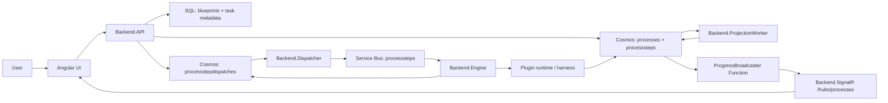

# Topology and Runtime

## Topology Source of Truth

`Backend.Topology` is the source of truth for runtime topology names, partition-key assumptions, config keys, and realtime routes/events. `Backend.AppHost/Program.cs` consumes those constants when creating local Aspire resources, and `BuildScripts/workflowbuilder-topology.json` is generated from the same catalog for scripts.

Key runtime resources wired there:

- SQL Server database for blueprint and task metadata
- Cosmos DB database with containers:
  - `processes`
  - `processdirectory`
  - `processsummaries`
  - `processrealtimesummaries`
  - `processnoderealtime`
  - `processsteps`
  - `processstepdispatches`
  - `processstepfinalizations`
  - `processprojectionleases`
  - `pluginingestionstatuses`
  - `plugintaskversionruntimestatuses`
  - `nodeactivations`
  - `nodejoinstates`
  - `phasedprocesses`
  - `phasecorrelations`
  - `processstepprogressleases`
- Blob Storage containers:
  - `plugins`
  - `artifacts`
- Service Bus queues for:
  - process-step execution
  - plugin reload
- Grafana, Loki, Tempo, Prometheus, and Alloy for observability
- API, Engine, Dispatcher, Projection Worker, Maintenance, SignalR, Plugin Detector, Progress Broadcaster, Plugin Seeder, and Blueprint Seeder services

The API currently exposes a fixed external HTTP endpoint on port `5180` in the AppHost. The UI development proxy expects `api/client-config`, `/hubs/processes`, and the SignalR event names in `Backend.Topology` to remain aligned with AppHost and UI runtime config.

Startup validation is intentionally strict. API, Engine, Dispatcher, Projection Worker, Maintenance, PluginDetector, ProgressBroadcaster, and SignalR fail fast when required SQL/Cosmos/Storage/Service Bus/realtime/client config is missing, placeholder-valued, or inconsistent with the canonical topology. AppHost may provide canonical local defaults, but direct service startup must provide explicit valid configuration.

## Service Ownership

| Service | Owns |
|---|---|
| `Backend.API` | Blueprint/process HTTP API, process queries, client-config |
| `Backend.Engine` | Execution kernel: consumes process-step messages, claims steps, validates plugin capabilities/configuration, executes plugins, finalizes normal results, activates downstream work, and runs native Collection Iterator steps |
| `Backend.Dispatcher` | Drains durable `processstepdispatches` intents and sends process-step Service Bus messages |
| `Backend.ProjectionWorker` | Maintains process directory, summary, realtime summary, and realtime node projections from canonical process/process-step state |
| `Backend.Maintenance` | Runs recovery and reconciliation loops such as finalization recovery and process-start reconciliation |
| `Backend.SignalR` | Hosts `/hubs/processes` subscriptions |
| `PluginDetector` | Reacts to plugin bundle uploads and registers task versions |
| `ProgressBroadcaster` | Watches Cosmos process-step changes and publishes SignalR updates |
| `PluginSeeder` | Seeds canonical bundles from `Backend.Plugins/_bundles` into blob storage |
| `BlueprintSeeder` | Seeds exported blueprints into the API |

## Design-Time Storage

SQL owns:

- blueprints and blueprint versions
- blueprint nodes and connections
- task definitions and task versions
- Collection Iterator node metadata
- phased blueprint definitions and versions
- phased blueprint phases, transitions, handoff mappings, and correlation mappings

Hand-authored migrations in `Backend.Database.Relational/Migrations` must remain discoverable by the migration service.

## Runtime Flow

## Process Lifecycle

1. The frontend calls `POST /api/blueprints/{id}/processes`.
2. The API resolves the selected blueprint version and creates initial process state.
3. The API persists process state, upserts compatibility process directory/summary projections, persists the initial step with durable dispatch intent, then attempts best-effort process-step queue dispatch.
4. `Backend.Dispatcher` drains durable dispatch intents and sends process-step queue messages. API and Engine may still opportunistically dispatch after intent creation.
5. `Backend.Engine` consumes the process-step queue.
6. The engine loads the executable blueprint and resolves the newest runnable task version.
7. Before launching a plugin runtime agent, the engine validates the plugin manifest capability requirements.
8. Capability validation includes required software probes, engine-side endpoint checks where configured, and required domain config/secret presence.
9. After capability validation succeeds, runtime config files are generated and passed to the plugin with repeated `--config` arguments.
10. The plugin runtime launches the plugin executable through the harness.
11. The plugin hydrates its required input/global state from Cosmos using the invocation envelope identifiers.
12. The plugin emits framed process-protocol stdout messages; result frames enter bounded finalization, then the engine updates process-step state and durably schedules downstream work as needed.
13. `Backend.ProjectionWorker` consumes canonical process/process-step changes and maintains query/realtime projections. Engine synchronous projection writes are compatibility behavior.
14. Cosmos changes in `processsteps` are observed by `ProgressBroadcaster`.
15. `ProgressBroadcaster` builds realtime batches from lightweight realtime projections and publishes them to SignalR subscribers.
16. The UI receives `processSummaryUpdated` and `processStepsUpdated` events and refreshes the process explorer state.

## Process Index And Query Model

The `processes` container remains the source of truth for runtime process state and is still partitioned by `/blueprintId`, which is the executable blueprint version id. That keeps existing process writes compatible, but a popular blueprint version can become a hot logical partition and point lookup requires knowing that version id.

New process writes also maintain two scalable projections:

- `processdirectory`, partitioned by `/id`, stores one record per process id. It maps `processId` to tenant, blueprint definition id, blueprint version id, current source partition key, status, and timestamps. Direct `GET /api/processes/{processId}` uses this record to point-read the source process without scanning blueprint versions.
- `processsummaries`, partitioned by `/partitionKey`, stores two small summary rows per process: a tenant/global row and a blueprint-version row. Partition keys follow `{tenantId}:{scope}:{scopeId}:{yyyyMM}:{shard}`, with tenant currently fixed to `default` and the shard derived deterministically from `processId`.

The summary projection is the query seed for recent-process and dashboard paths. Recent processes across blueprints read tenant-scope rows; blueprint history/search read blueprint-scope rows, then hydrate source process and step documents only for candidates that need global-state, node-status, or node-property filtering. Projection reads are eventually consistent with the source `processes` record, and legacy blueprint-scoped routes fall back to the old version-partition scan while existing data is being backfilled.

Existing deployments can opt into projection repair by running the migration service with `ProcessIndexBackfill:Enabled=true`. The backfill enumerates SQL blueprint versions, pages the existing `processes` partitions, and idempotently upserts directory and summary rows. It is safe to rerun and can be throttled with `ProcessIndexBackfill:BatchSize`.

`Backend.ProjectionWorker` is the long-running owner for projection maintenance. It consumes Cosmos change feed records from `processes` and `processsteps`, stores leases in `processprojectionleases`, and can repair a single process projection from canonical process plus process-step records. Engine synchronous projection writes are controlled by `Projections:SynchronousEngineUpdatesEnabled`, which defaults to `true` for compatibility. Set it to `false` in production once ProjectionWorker is running and healthy so Engine remains focused on execution.

## Realtime Projection Model

Realtime broadcasting uses lightweight projections so change-feed batches do not reload every process step for the changed process.

- `processrealtimesummaries`, partitioned by `/id`, stores one row per process with blueprint identity, aggregate process status, runtime step counts, and compact per-step status contributions for idempotent updates.
- `processnoderealtime`, partitioned by `/processId`, stores one row per process node with aggregate runtime-step status, latest runtime step id, timestamps, failure summary, and compact per-runtime-step contributions for fan-out and Collection Iterator aggregation.

API process start and Engine step claim/finalization can update these projections best-effort when compatibility synchronous updates are enabled. `Backend.ProjectionWorker` is the async owner and rebuilds the same projection rows from canonical state. The `processes` and `processsteps` containers remain authoritative: process detail pages still load full source state, and `ProgressBroadcaster` falls back to a full source load only when a realtime projection is missing, then repairs the projection for later batches. Projection write failures are observable through realtime projection metrics and should not fail process execution.

## Step Dispatch Guarantee

Process-step scheduling is at-least-once. Every new pending `ProcessStepRecord` carries an embedded `dispatch` projection for display/debugging, and the authoritative queue-dispatch intent is written to `processstepdispatches` before process start is accepted or downstream finalization advances.

Durable dispatch is a normal-execution invariant. API and Engine startup reject `ProcessStepDispatch:Enabled=false`, and production dispatch services throw before process or downstream step creation can strand pending work; tests that intentionally bypass dispatch must use an explicit test dispatcher.

`processstepdispatches` is partitioned by `/partitionKey`, using absolute due-bucket and shard keys for dispatch attempts plus cursor records per shard. API process start and Engine downstream activation may attempt immediate Service Bus dispatch, but enqueue failure does not strand the step once the intent exists. `Backend.Dispatcher` runs the dispatch worker that advances shard cursors through due buckets, queries exact bucket/shard partitions, claims pending or expired dispatching intents with a short lease, sends the deterministic process-step message, and marks the intent and step projection as dispatched only after Service Bus send succeeds. Retryable failures create a new future-bucket attempt record and update the step projection with the active intent id, bucket, shard, and retry metadata.

Join state uses materialization language. For multi-input joins, `nodejoinstates.activationMaterialized` means the joined activation has been durably materialized as a deterministic process step with dispatch intent; it does not mean Service Bus delivery has happened. New records write `activationMaterialized` and `materializedProcessStepId`; legacy `stepEnqueued` and `enqueuedProcessStepId` records are read into the same semantics. If marking materialization fails, finalization remains retryable and resume repairs the marker before downstream activation is considered complete.

Duplicate Service Bus messages are safe: process-step queue messages use the process step id as the deterministic message id for diagnostics and future broker duplicate detection, while the real correctness guard remains the idempotent step claim, which only transitions `Pending` steps to `InProgress`. Legacy completed or failed steps without dispatch metadata are treated as settled; legacy pending steps can be reconciled into `processstepdispatches` by running the migration service with `ProcessStepDispatchBackfill:Enabled=true`.

## Process Start Reconciliation

New process records include a `start` snapshot with the deterministic initial step id, initial blueprint node id, and initial input hydration plan. This lets Maintenance repair the narrow partial-failure window where the `processes` record was created but the initial `processsteps` record was not.

`Backend.Maintenance` hosts `ProcessStartReconciliationWorker`. It is disabled by default and can be enabled with `ProcessStartReconciliation:Enabled=true`. It scans recent `Pending`/`InProgress` processes from `processsummaries` plus a bounded fallback over `processes`, skips terminal source records, recreates a missing initial step only for `Pending` processes with a valid start snapshot, and repairs missing initial-step dispatch intent through the durable dispatch scheduler.

## Step Finalization Guarantee

Plugin-backed steps and native Collection Iterator steps finalize through the `processstepfinalizations` outbox container. The engine writes a `ResultReceived` checkpoint before mutating step or process state, advances explicit stages as outputs/failures, downstream activation, and phase/process effects become durable, and only acknowledges the process-step queue message after the finalization record reaches `QueueMessageCompletionPrepared`.

If a queue message is redelivered for a step with an incomplete finalization record, the engine resumes from the recorded stage instead of re-running the plugin or native operator. Downstream step creation remains idempotent because runtime step ids are deterministic and inserts use create-if-not-exists semantics. Legacy completed or failed steps without a finalization record are treated as already settled.

`Backend.Maintenance` hosts `StepFinalizationRecoveryWorker` for incomplete outbox records that need recovery outside the active queue-message lock. Normal finalization remains inside `Backend.Engine` so claim, plugin result handling, downstream activation, and queue-message completion stay together.

## Engine Capabilities

Plugin prerequisites are capability-owned:

- plugins declare `.RequireCapability<TCapability>()`, not direct configuration requirements
- capability types live under `Backend.Engine.Capabilities`
- capabilities may own typed domain config contracts from `Backend.Plugins.Configuration.*`
- generated manifests contain `capabilities.requirements[]` plus flattened `configuration.requirements[]` derived from those capabilities
- missing required capabilities make a plugin version unrunnable; if multiple versions exist, routing chooses the newest runnable version
- optional capability failures remain visible in validation reports but do not block routing

The engine exposes:

- `GET /api/engine-capabilities`
- `POST /api/engine-capabilities/validate`

V1 exposes remediation metadata and validation results, but does not install missing software automatically.

## Collection Iterator Lifecycle

Collection Iterator is a native engine operator, not a packaged plugin.

1. The blueprint graph stores a Collection Iterator node with collection input and item output shape.
2. The frontend renders it as a compact splitter operator.
3. Ports stay generic until a collection source mapping determines the item kind.
4. `Backend.Engine/CollectionIteratorExecutionService.cs` expands collection items for downstream work.
5. Process projections and step details preserve iterator identity and item flow for inspection.

Collection Iterator should stay distinct from Phase Series. A phase is a coarse blueprint-to-blueprint handoff boundary with Data Bridge and optional trigger/correlation behavior; an iterator is dynamic in-process fan-out with item-scoped downstream steps.

When changing collection typing, update backend validation/projection, frontend node modeling, and canvas rendering together.

## Phased Blueprint Runtime

Phased blueprints let users version a series of blueprint versions and Data Bridge mappings.

Important backend pieces:

- `Backend.API/Controllers/PhasedBlueprintsController.cs`
- `Backend.API/Services/PhasedBlueprintProcessService.cs`
- `Backend.Repositories/PhasedBlueprintRepository.cs`
- `Backend.Repositories/PhaseCorrelationRepository.cs`
- `Backend.Repositories/PhasedProcessRepository.cs`
- `Backend.Repositories/PhasedProcessFinalizationService.cs`
- `Backend.DTOs/InputModels/PhasedBlueprint*`
- `Backend.DTOs/ViewModels/PhasedBlueprint*`
- `Backend.Database.Relational/Entities/PhasedBlueprint*`

Phase handoff mappings are design-time SQL data. Runtime phase correlation and finalization state must remain consistent with process and process-step Cosmos state.

## Plugin Ingestion Path

1. Canonical bundle ZIPs are uploaded to the plugin blob container.
2. `PluginDetector` records durable ingestion status in `pluginingestionstatuses`, extracts the bundle, reads `manifest.json` and schemas, validates capability/configuration metadata, and registers or updates task versions in SQL.
3. Missing/invalid manifests, ABI incompatibility, schema failures, and capability/configuration metadata failures append sanitized failure events and quarantine the bundle in status metadata. Quarantined bundles remain in blob storage, but detector reconciliation skips them until an admin unquarantine operation clears the gate.
4. Duplicate bundles are recorded as `DuplicateIgnored`; successful bundles are recorded as `Registered`.
5. Runtime loading failures and stale ABI metadata append operational status for the task version without writing into the SQL task catalog.
6. The detector emits a plugin reload request so the engine refreshes its in-memory runtime catalog.

Plugin ingestion is not hosted by `Backend.Engine`. The engine loads runnable bundles, reports runtime availability, and responds to plugin reload requests; bundle detection, quarantine, SQL registration, ingestion status, and reload request creation remain with `PluginDetector`.

## Local Development Startup

`Backend.AppHost` starts `backend-engine`, `backend-dispatcher`, `backend-projection-worker`, and `backend-maintenance` as separate local services wired to the same SQL, Cosmos, Service Bus, Blob Storage, and observability resources. The split should not add a network hop to normal plugin execution: Engine still consumes process-step messages directly and invokes plugins locally, while Dispatcher, ProjectionWorker, and Maintenance handle async loops around the kernel.

## Plugin Runtime Availability

SQL task-version records mean a plugin version is registered, not that the current Engine fleet can run it. Engine instances publish per-task-version runtime observations to `plugintaskversionruntimestatuses`, partitioned by `/taskVersionId`, with the reporting engine instance id, current runtime status, sanitized failure message, compact capability issues, and `lastSeenAt`.

`GET /Tasks` enriches SQL task versions with fleet-aggregated runtime availability. Fresh observations are counted only within `PluginRuntimeStatus:StaleAfterSeconds`; if any fresh engine reports `Runnable`, the task version is exposed as runnable. ABI incompatibility, missing software/network capabilities, missing required configuration, startup failures, and intentional unloads remain visible as operational runtime state outside the canonical SQL catalog.

## Important Runtime Invariants

- `Backend.Topology` is the authoritative place for topology names; AppHost is the local resource wiring layer.
- Keep `BuildScripts/workflowbuilder-topology.json` regenerated from `Backend.Topology` when topology constants change.
- SQL is design-time and catalog state; Cosmos is live runtime state.
- The engine and dispatcher depend on the process-step queue configuration staying aligned across AppHost, tests, and smoke scripts.
- ProjectionWorker depends on `processprojectionleases` and the canonical `processes`/`processsteps` change feeds.
- The progress broadcaster depends on Cosmos binding configuration being correct at startup.
- Realtime is part of the normal product flow, not optional observability garnish.
- Phased blueprint process startup and finalization must keep phase correlation state, process state, and projected process detail in agreement.
- Collection Iterator behavior is engine-native; do not model it as a plugin bundle.
- Plugin configuration is capability-owned; do not reintroduce direct plugin `.RequireConfiguration<TOptions>()` declarations.
- Capability contracts live under `Backend.Engine.Capabilities`; shared config contracts live under `Backend.Plugins.Configuration.*`.
