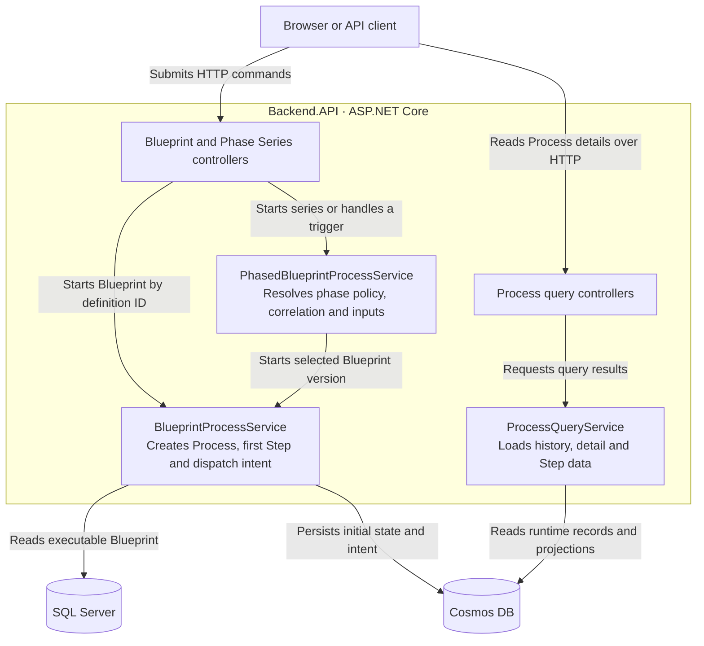
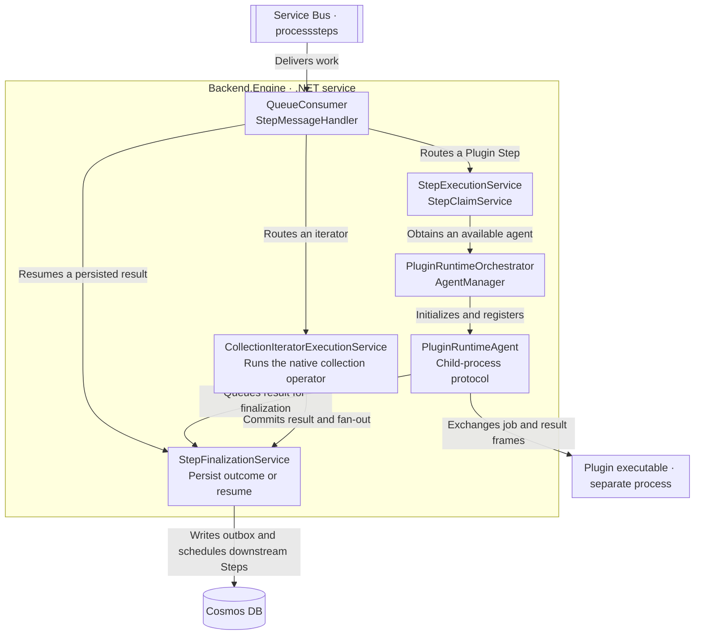
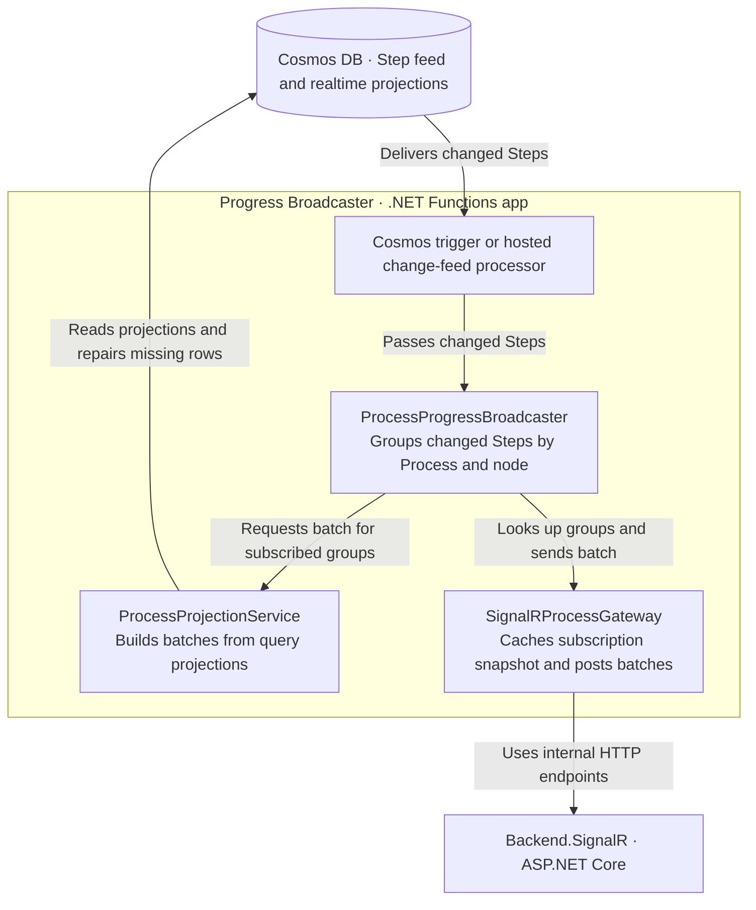

# Components · WorkflowBuilder

**C4 Level 3.** Each boundary below encloses components in one application. Nodes outside a boundary are neighboring containers. Start with the API to understand version selection, the Engine to follow Step execution, or the Progress Broadcaster to trace a live update.

## API

Blueprint start and phase handoff share the same start service. The API can attempt a Service Bus send before returning acceptance. Other controller families serve the task catalog, observability and Plugin ingestion administration. [Blueprint start](../../Backend.API/Services/BlueprintProcessService.cs) · [Phase start and trigger](../../Backend.API/Services/PhasedBlueprintProcessService.cs) · [Query service](../../Backend.API/Services/ProcessQueryService.cs)

## Engine

Plugin jobs go to running agents. Startup and reload perform ABI, capability and configuration checks. During a Plugin job, Engine renews the Service Bus lock. A bounded result queue feeds workers which call the execution service and then the finalizer. Engine can also execute a Collection Iterator entirely in-process. [Message routing](../../Backend.Engine/StepMessageHandler.cs) · [Agent lifecycle](../../Backend.Engine/PluginRuntimeOrchestrator.cs) · [Result worker](../../Backend.Engine/PluginResultFinalizationWorker.cs) · [Code view](engine-execution.md)

## Progress Broadcaster

The SQL-backed Blueprint lookup resolves definition IDs for Blueprint subscribers. The broadcaster can skip work when nobody subscribes. SignalR delivers summary events to Blueprint groups and node events to Process groups. [Batch builder](../../Backend.Functions.ProgressBroadcaster/Services/ProcessProgressBroadcaster.cs) · [Internal gateway](../../Backend.Functions.ProgressBroadcaster/Services/SignalRProcessGateway.cs) · [SignalR group delivery](../../Backend.SignalR/Program.cs)

[Runtime interactions](interactions.md) · [Container views](containers.md) · [Architecture index](README.md)
