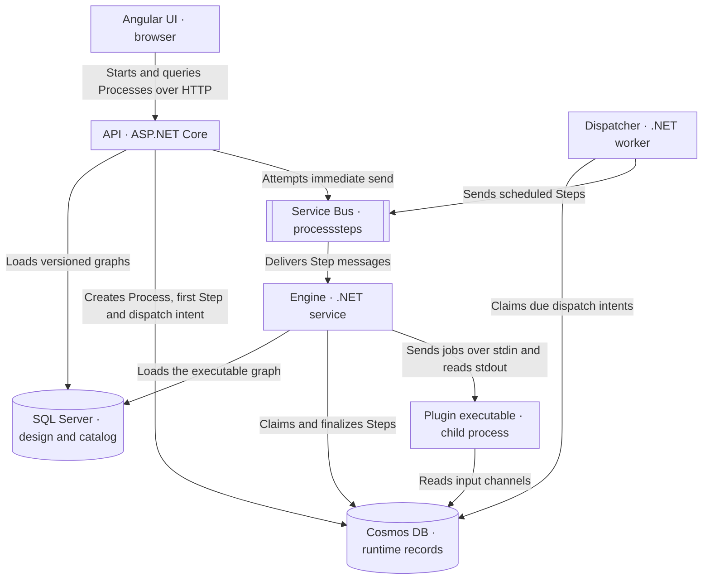
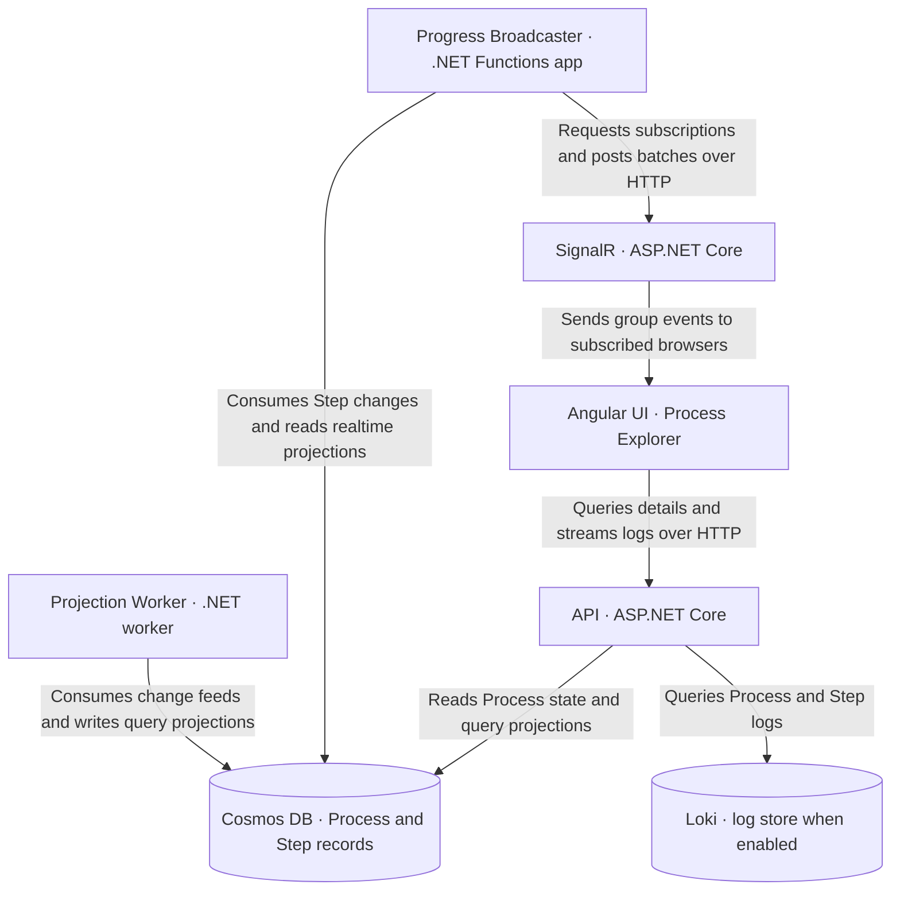
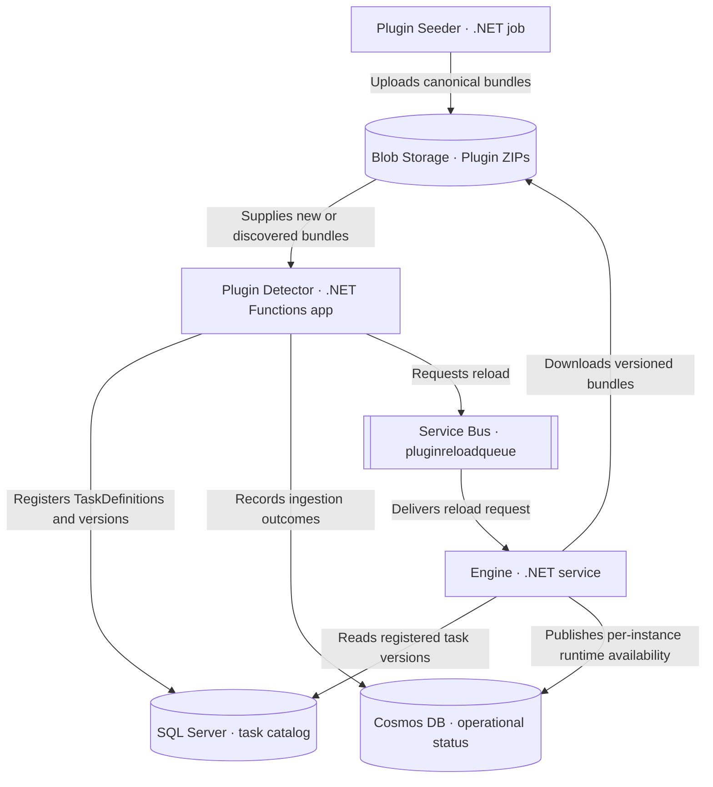

# Containers · WorkflowBuilder

**C4 Level 2.** Each diagram shows a slice of the same system. Repeated names denote the same application or store. The diagrams group the product by the work it does. Environment-specific placement and optional services are in the [deployment views](deployment.md).

## Starting and executing a Process

An external API client can start the same Process. Engine can also send newly scheduled Steps immediately. A durable Cosmos intent lets Dispatcher retry a send. Maintenance is a separate .NET worker which can repair an incomplete Process start or resume a Step finalization from its checkpoint. The Collection Iterator executes inside Engine. [Lifecycle and guarantees](../agent-context/topology-and-runtime.md) · [Engine components](components.md#engine)

## Observing a Process

Dashboard gets summaries over the observability HTTP API. SignalR delivers progress events to Process Explorer. Live Process and Step logs use server-sent events (SSE) from the API. When configured, the observability stack collects traces, logs and metrics and exposes them in Grafana. [Interactions](interactions.md) · [Observability endpoints](../../Backend.API/Controllers/ObservabilityController.cs)

## Registering and loading Plugins

The Seeder also calls the same bundle processor as Detector, so seeded bundles can register and request reload directly. Engine validates declared capabilities, starts the executable and registers its agent as runnable. A version can appear in the SQL catalog before it becomes runnable on a particular Engine. [Bundle registration](../../Backend.Services/PluginBundleProcessingService.cs) · [Agent startup](../../Backend.Engine/PluginRuntimeOrchestrator.cs)

| Other application or store | Responsibility |
| --- | --- |
| Migration Service · .NET job | Applies relational migrations and configured runtime backfills. |
| Blueprint Seeder · .NET job | Imports seed Blueprints through the API after its prerequisites are ready. |
| Blob Storage · artifacts | Stores artifact content separately from Plugin bundle ZIPs. |
| Keycloak · OIDC provider | Issues identity tokens when authentication is enabled. |

[Explore the components](components.md) · [Deployment](deployment.md) · [Architecture index](README.md)
