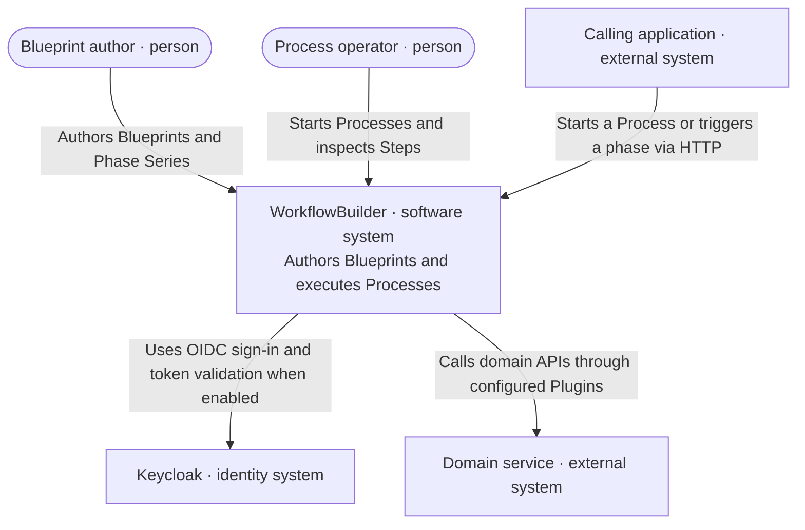
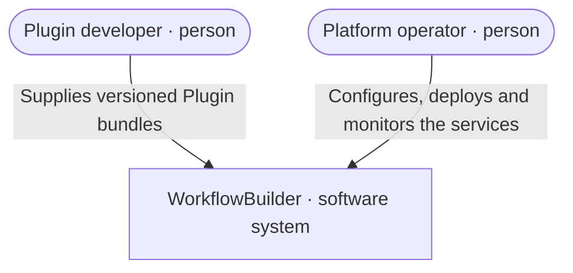

# System context · WorkflowBuilder

**C4 Level 1.** A Blueprint author describes repeatable work, a caller starts a Process, and an operator follows the Steps that execute. A Phase Series connects multiple Blueprints. A Data Bridge maps the outputs of one phase into the next.

A Plugin developer supplies a packaged task implementation. Platform engineers deploy it and run the services. A business process owner may also act as author or operator. The stakeholder profiles describe needs beyond the currently implemented interfaces. [Stakeholder profiles](../stakeholder-roles/README.md) · [Plugin development](../agent-context/plugin-development.md)

The public Blueprint start endpoint resolves the latest version for a Blueprint definition. Phase Series can select a pinned Blueprint version or resolve the latest version for a phase. The Phase Series API also accepts external triggers for eligible phase transitions. [Blueprint start service](../../Backend.API/Services/BlueprintProcessService.cs) · [Phase start and trigger service](../../Backend.API/Services/PhasedBlueprintProcessService.cs)

[Explore the containers](containers.md) · [Architecture index](README.md)
