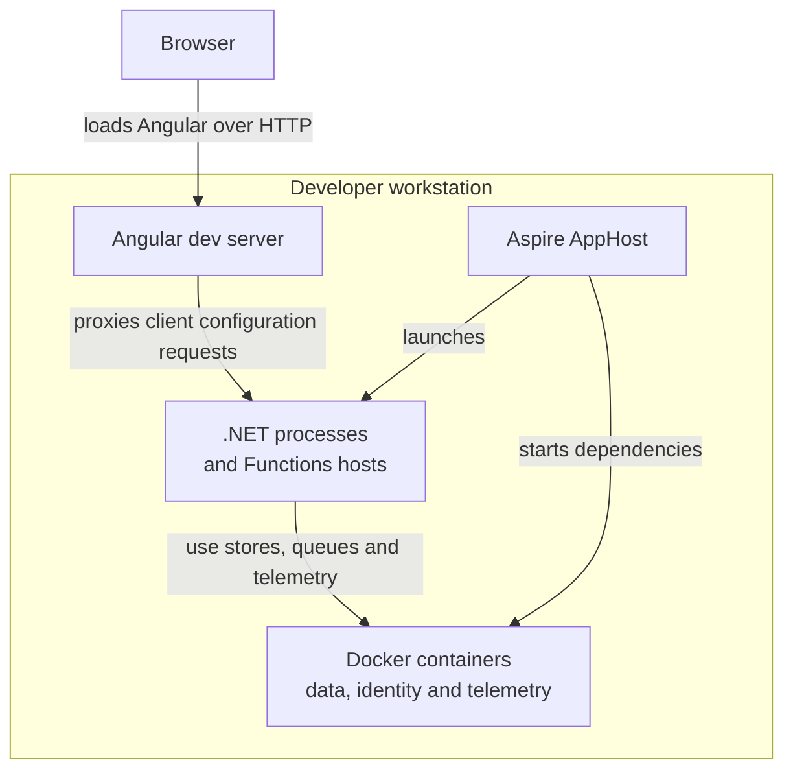
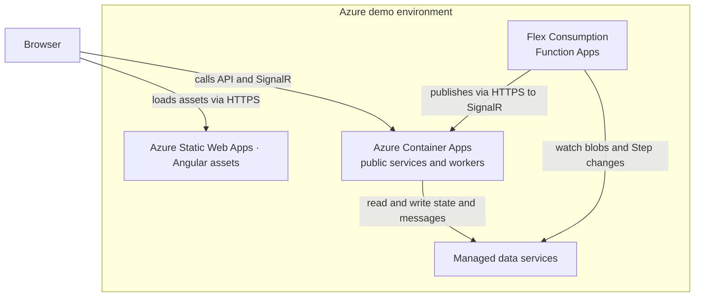

# Deployment views

These C4 deployment views locate the running parts of WorkflowBuilder. Read from the browser to the services and stores. Each outline is a hosting boundary, each box names one or more deployed instances, and each arrow names the interaction and its direction. Grouped instances share a hosting technology and have distinct processes or resources. For the order of a Process start, Plugin registration or live update, see the [runtime interactions](interactions.md).

## Local development with Aspire

The AppHost `http` launch profile starts backend projects on the developer machine and dependencies in Docker. It sets `Frontend__Enabled=false`. The developer runs the Angular dev server separately. Setting `Frontend:Enabled=true` lets AppHost start that server in Docker. The two Functions run through Azure Functions hosts. Engine launches reusable Plugin executables on its own host when it prepares or reloads the catalog.

| Location | Instances |
| --- | --- |
| Developer machine | Backend.API, Backend.SignalR, Engine and its Plugin child processes, Dispatcher, ProjectionWorker and Maintenance. PluginDetector and ProgressBroadcaster run as isolated Functions. Database MigrationService and the two seeders run at startup. |
| Docker data and identity services | SQL Server, Cosmos DB emulator, Azurite, Service Bus emulator and Keycloak with the local realm import. |
| Docker telemetry services | Alloy, Loki, Tempo, Prometheus and Grafana. |

The local bootstrap file uses the same-origin API proxy to fetch client configuration. That configuration supplies the API and hub addresses. Alloy forwards telemetry from instrumented services to the Aspire dashboard and the local telemetry stores. SQL and Cosmos use session lifetimes by default. Existing data and seeded bundles depend on the selected persistence settings and the local bundle directory. [AppHost](../../Backend.AppHost/Program.cs) · [Launch profiles](../../Backend.AppHost/Properties/launchSettings.json) · [Alloy configuration](../../Infra/Observability/alloy/config.alloy)

## Azure demo

Terraform provisions the infrastructure. The deployment workflow pushes images, updates Container App revisions, deploys Function packages and the Angular build, and can upload Plugin bundles and run database migrations. This view shows the checked-in demo example.

| Azure hosting resource | Instances and responsibilities |
| --- | --- |
| Static Web Apps | Angular application and its same-origin bootstrap file. |
| Container Apps | Backend.API and Backend.SignalR expose public ingress. Engine and Dispatcher have no ingress. Each Plugin executable runs inside its Engine replica. |
| Flex Consumption Function Apps | PluginDetector registers uploaded bundles. ProgressBroadcaster reads Step changes and publishes to SignalR. Each has its own package container. |
| Managed data services | Azure SQL Database for design data, Cosmos DB for runtime state, Blob Storage for bundles and artifacts, and Service Bus for Step and Plugin reload queues. |
| Configuration and release | Azure Container Registry stores images. Container Apps bootstrap from App Configuration using managed identity and resolve Key Vault references. Function App settings provide bindings and, by default, the settings needed by each worker. |

The demo uses a generated shared secret for the broadcaster. Authentication and Keycloak are disabled in the example. Enabling Keycloak adds a public Container App and requires configuring its realm and clients. API and SignalR expose application endpoints, including SignalR's credential-checked publisher routes. Functions have trigger bindings and Azure host endpoints. Access to managed data services follows their own network and credential settings. [Demo settings](../../Infra/Terraform/environments/demo/terraform.tfvars.example) · [Terraform modules](../../Infra/Terraform/main.tf) · [Authentication](../authentication-keycloak.md)

| Environment | What changes for operators |
| --- | --- |
| Local development | ProjectionWorker runs and the Engine writes projections synchronously by default. Maintenance runs, while its recovery loops require their own enable flags. Grafana, Loki, Tempo, Prometheus and Alloy run locally. |
| Azure demo example | API, SignalR, Engine and Dispatcher can scale to zero. ProjectionWorker and Maintenance are optional and disabled in the example. The Engine writes projections synchronously. The Terraform deploys neither the local telemetry stack nor a Loki service for the UI log pane. |
| Local non-functional test (NFT) profile | The minimal launch profile enables Dispatcher and ProjectionWorker with asynchronous projections. It disables the frontend, user authentication, SignalR, both Functions, Maintenance and the local observability stack. The test runner may override profile settings for its scenario. |
| Azure NFT override | The load injector stays local. The override keeps API, Engine, Dispatcher and ProjectionWorker at one replica each, enabling asynchronous projections. The other demo settings come from the base file. |

[Terraform deployment guide](../../Infra/Terraform/README.md) · [Azure NFT overrides](../../Infra/Terraform/environments/demo/nft.tfvars.example) · [Performance test runner](../../PerformanceTests/README.md) · [Operational diagnosis](../how-to/operations.md)

## Enabling Conditional Branch authoring

The API enables Conditional Branch authoring in Development. In Production, enable it after the additive Blueprint database migration and the updated API, Engine, Dispatcher, Maintenance, projection and progress services, and UI have been deployed. Drain older Engine replicas before enabling authoring so every consumer understands the new node kind. The integration AppHost opts in for its API.

Set `Features__ConditionalBranchAuthoring__Enabled=true` on the API and restart its replicas. Confirm that `GET /api/client-config` returns `features.conditionalBranchAuthoring: true`. Publish a test Blueprint and exercise both outcomes. Verify the selected output and skipped Steps in Process Explorer and confirm the Process completes.

To suspend new branch versions, set the API variable to `false` and restart its replicas. The API then rejects Blueprint creation, versioning and imports containing a Conditional Branch. Keep branch-capable workers deployed while saved versions are available for Process starts or recovery.
