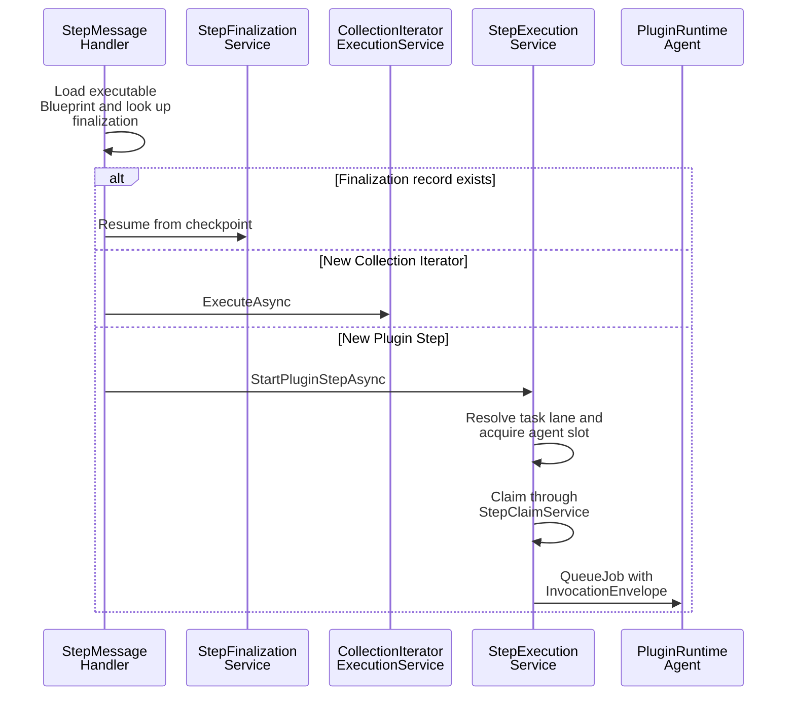
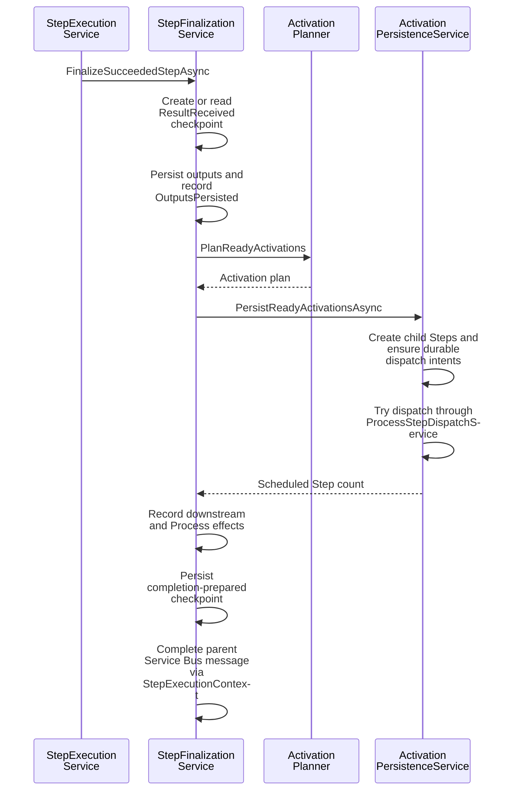
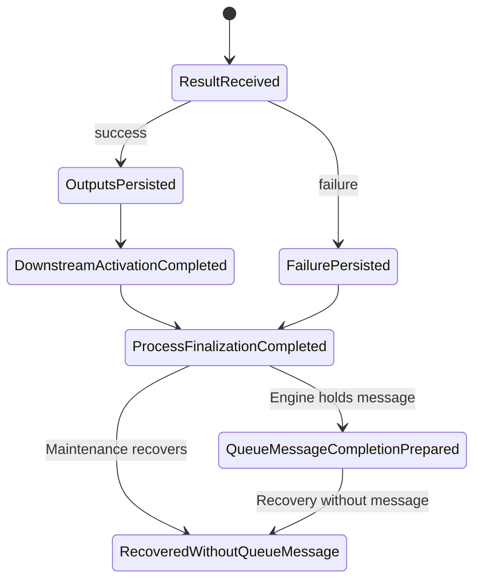

# Engine execution · From first Step to downstream work

**C4 Level 4, selected code path.** These views follow one successful Plugin-backed Step and the recovery paths for its persisted result. Each sequence names the C# types which hand work to each other. Store and queue operations across a process boundary are identified explicitly.

## Creating and claiming the first Step

For a direct Blueprint start, `BlueprintsController.StartProcess` calls `BlueprintProcessService.StartLatestVersionAsync`. The start service resolves the latest version, records the Process and creates a pending Step with a deterministic ID. It asks `ProcessStepDispatchService` to persist an intent and try an immediate send. The API returns HTTP 202 with a Process ID. If the immediate send fails after the intent is durable, Dispatcher can deliver it later. [Start implementation](../../Backend.API/Services/BlueprintProcessService.cs) · [Dispatch service](../../Backend.Services/ProcessStepQueue/ProcessStepDispatchService.cs)

Engine's `QueueConsumer` receives that message and passes it to the handler. The first lookup determines whether this delivery should resume a result or start a fresh Step.

A Plugin job runs on an already initialized child executable. The harness hydrates the input channels identified by the envelope. A result frame for a known job enters `PluginResultFinalizationQueue`. `PluginResultFinalizationWorker` takes the result and calls `HandlePluginResultAsync`. The native Collection Iterator follows another branch in the message handler and enters the same finalization service. [Message handler](../../Backend.Engine/StepMessageHandler.cs) · [Step execution](../../Backend.Engine/StepExecutionService.cs) · [Protocol session](../../Backend.Engine/PluginRuntimeProtocolSession.cs) · [Result worker](../../Backend.Engine/PluginResultFinalizationWorker.cs)

## Finalizing the parent and scheduling children

For a join, the planner examines inbound observations and can recalculate the plan after loading join readiness. Persistence creates deterministic child Steps and records their dispatch intents before marking the joined activation materialized. Each child returns through the Step queue. An interrupted enqueue can therefore be retried without creating a second child. [Activation planner](../../Backend.Engine/ActivationPlanner.cs) · [Activation persistence](../../Backend.Engine/ActivationPersistenceService.cs) · [Finalization service](../../Backend.Engine/StepFinalizationService.cs)

## Durable checkpoints and resumption

**If the queue lock is lost after a Plugin returns, check whether `ResultReceived` was persisted.** A result frame in memory can be lost before that write. If the active Step is reset and redelivered, the Plugin can run again, including any calls it made to other systems. Once the result is persisted, the handler finds the checkpoint first and calls `ResumeStepFinalizationAsync`. It resumes the recorded effects and settles the redelivered message. [Message handler](../../Backend.Engine/StepMessageHandler.cs) · [Active Step cleanup](../../Backend.Engine/StepExecutionService.cs)

Each name below is a value persisted on `ProcessStepFinalizationRecord` in Cosmos DB. The paths converge after the outcome-specific effects. Engine prepares for broker completion while it holds a message. With `FinalizationRecovery:Enabled=true`, Maintenance can finish outstanding effects without that message. The recovery loop is opt-in. [Recovery settings](../../Backend.Maintenance/MaintenanceServiceCollectionExtensions.cs)

| If execution stops here | What the next attempt does | Evidence |
| --- | --- | --- |
| A pending Process has a start snapshot but its initial Step is missing | When enabled, Maintenance recreates the initial Step from the snapshot and repairs the dispatch intent. | `Pending_process_without_initial_step_is_repaired_from_start_snapshot` in [start reconciliation tests](../../Backend.Engine.Tests/ProcessStartReconciliationServiceTests.cs). |
| The intent exists but the queue send fails | Dispatcher claims the due intent, retries the send and records success. | `Dispatch_failure_keeps_intent_retryable_and_worker_later_sends` in [dispatch tests](../../Backend.Engine.Tests/ProcessStepDispatchServiceTests.cs). |
| The agent exits before a result is durable | The Engine attempts to reset the active Step and abandon the message for another attempt. A failure in that cleanup can leave the message unsettled. | `HandlePluginAgentExitedAsync_resets_active_step_abandons_message_and_releases_slot` and the cleanup-failure case in [execution tests](../../Backend.Engine.Tests/StepExecutionServiceTests.cs). |
| Success or failure has an intermediate checkpoint | Redelivery finds the record before invoking the Plugin. The finalizer resumes the recorded branch. A failed Step skips child activation. | `Resume_success_finalization_from_each_intermediate_stage_completes_branch` and its failure counterpart in [finalization tests](../../Backend.Engine.Tests/StepFinalizationServiceTests.cs). |
| A join marker or iterator fan-out is partly written | Replay repairs the marker and reuses deterministic Step IDs. | `Join_materialization_failure_is_retryable_and_resume_repairs_marker` and `Collection_iterator_finalization_resumes_fan_out_without_duplicate_steps` in [finalization tests](../../Backend.Engine.Tests/StepFinalizationServiceTests.cs). |
| The broker rejects completion after the durable checkpoint | Redelivery attempts message completion again. `QueueMessageCompletionPrepared` records that effects are durable. | `Queue_message_completion_failure_leaves_durable_terminal_prepared_stage_for_retry` in [finalization tests](../../Backend.Engine.Tests/StepFinalizationServiceTests.cs). |
| Maintenance recovers a success or failure without a queue lock | It rebuilds the context and resumes the appropriate branch, recording `RecoveredWithoutQueueMessage`. A later delivery only completes the message. Missing source records can be marked unrecoverable. | `Recovery_resume_success_from_outputs_persisted_activates_downstream_without_queue_message`, `Recovery_resume_failure_from_failure_persisted_marks_recovered_without_queue_message` and the redelivery and missing-Step cases in [recovery tests](../../Backend.Engine.Tests/StepFinalizationServiceTests.cs). |

The stage machine rejects skipped, backwards and cross-branch transitions. The historical serialized value `QueueMessageCompleted` reads as `QueueMessageCompletionPrepared`. [Stage machine](../../Backend.Engine/ProcessStepFinalizationStageMachine.cs) · [Transition and compatibility tests](../../Backend.Engine.Tests/ProcessStepFinalizationStageMachineTests.cs) · [Maintenance recovery service](../../Backend.Maintenance/StepFinalizationRecoveryService.cs)

[Engine components](components.md#engine) · [Architecture index](README.md)
