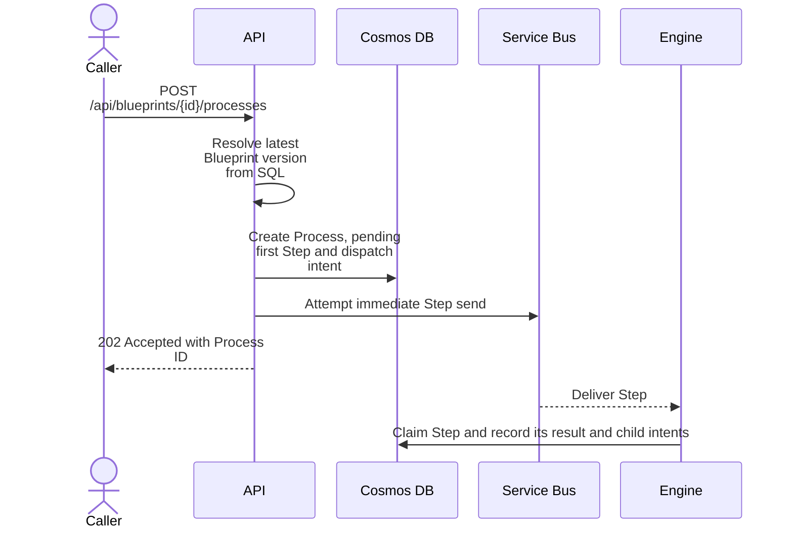
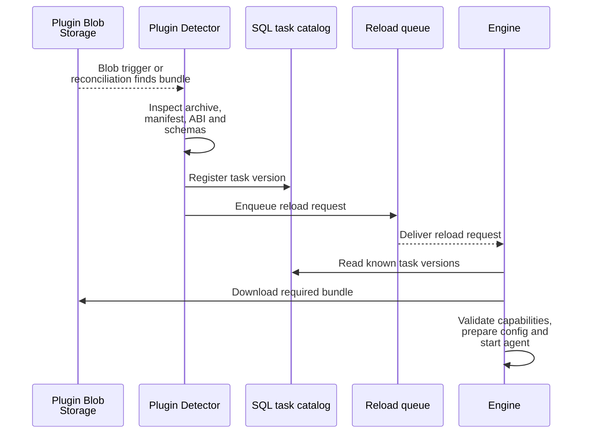
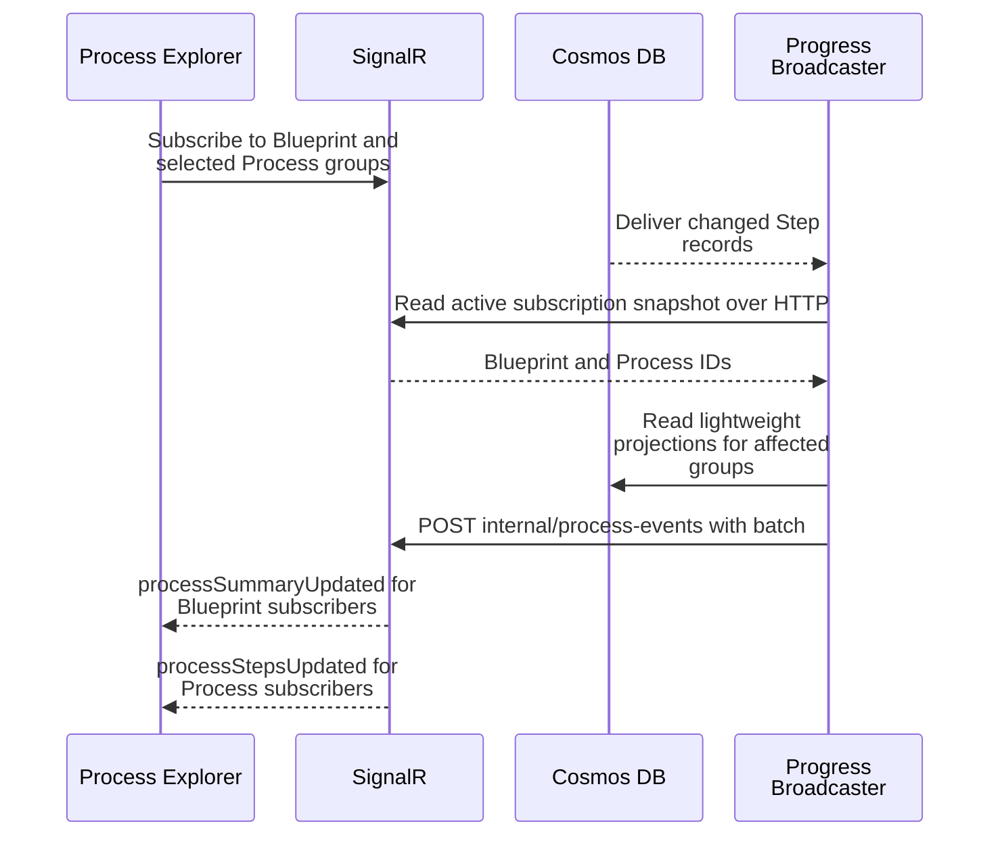

# Runtime interactions

These dynamic views follow messages across the containers. Each shows a different starting event so that a Plugin catalog reload, a Step execution and a live notification can be diagnosed independently.

## A caller starts a Process

HTTP acceptance means durable scheduling. Dispatcher drains due intents when an immediate send fails. The first Step can have finished by the time the caller reads the response. A phase start goes through the Phase Series service first, which applies its version policy and supplies initial inputs to the Blueprint start path. [Dispatch guarantees](../agent-context/topology-and-runtime.md#step-dispatch-guarantee) · [First Step code view](engine-execution.md)

## A bundle becomes a runnable Plugin

During local seeding, Plugin Seeder uploads a canonical ZIP if needed and calls the shared bundle processor itself. Detector uses that same processor for uploads and periodic reconciliation. Cosmos records ingestion outcomes and per-Engine runtime status separately. Engine also loads its catalog at startup. A registered version becomes runnable on an Engine once its agent is ready. [Seeder](../../Backend.PluginSeeder/PluginSeedingHostedService.cs) · [Bundle processor](../../Backend.Services/PluginBundleProcessingService.cs) · [Engine catalog load](../../Backend.Engine/PluginRuntimeOrchestrator.cs)

## Process Explorer receives a live update

Projection Worker consumes the canonical Process and Step change feeds independently. The broadcaster may use a cached subscription snapshot, skips uninterested groups and can rebuild missing projection rows. A successful Process can therefore coexist with an out-of-date browser view. Dashboard uses HTTP summaries. Live log streams use SSE from the API. [Realtime implementation](../../Backend.Functions.ProgressBroadcaster/Services/ProcessProgressBroadcaster.cs) · [End-to-end registration, execution and SignalR tests](../../IntegrationTests/WorkflowBuilder.IntegrationTests/EndToEnd/PluginIngestionAndProcessExecutionTests.cs) · [Operations](../how-to/operations.md)

[Container views](containers.md) · [Architecture index](README.md)
